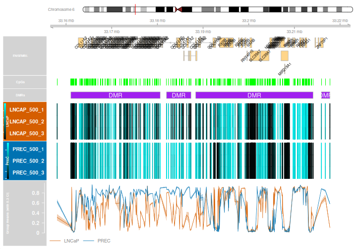

::::::::::::::::::::::::::::::::::::: questions

- How do we identify and visualise differentially methylated regions?
- How do probe filtering, remapping and thresholds affect the regions we find?

::::::::::::::::::::::::::::::::::::::::::::::::

::::::::::::::::::::::::::::::::::::: objectives

- Prepare M-values, a design matrix and a contrast for DMRcate.
- Identify, inspect and plot differentially methylated regions.
- Explore EPICv2 probe remapping. 

::::::::::::::::::::::::::::::::::::::::::::::::

## Differential methylation analysis of regions (DMRs)

A differentially methylated region (DMR) contains neighbouring CpG sites with evidence of differential methylation. DMRcate combines spatial information with probe-wise statistics: a region is not simply a list of significant DMPs within a gene. Region boundaries also depend on probe coverage and analysis settings.

## Prepare the inputs

Start from the normalised, filtered data saved in episode 2. This object has already had cross-reactive probes removed and replicate probes collapsed.
Use M-values for modelling and beta values for visualisation. DMRcate fits probe-wise models internally; it does not use the `topTable()` results from episode 3 (DMPs) as input.


``` r
library(minfi)
library(limma)
library(DMRcate)
library(IlluminaHumanMethylationEPICv2anno.20a1.hg38)

mSetFnFlt <- readRDS("data/processed/normalised-filtered.rds")
targets <- readRDS("data/processed/targets.rds")
mVals <- getM(mSetFnFlt)
bVals <- getBeta(mSetFnFlt)

sampleType <- droplevels(factor(targets$Type))
design <- model.matrix(~0 + sampleType)
colnames(design) <- levels(sampleType)
contMatrix <- makeContrasts(LNCaP_vs_PREC = LNCaP - PREC, levels = design)
contMatrix
```

``` output
       Contrasts
Levels  LNCaP_vs_PREC
  LNCaP             1
  PREC             -1
```

This tests **LNCaP minus PrEC**: positive effects indicate higher methylation in LNCaP and negative effects indicate higher methylation in PrEC.

## Annotate probes and identify regions

`cpg.annotate()` attaches genomic locations and calculates statistics for the selected comparison.
`fdr` defines the threshold for individually significant CpGs used by DMRcate's default region thresholding.

We disable remapping for this baseline analysis because cross-reactive probes were removed earlier.


``` r
myAnnotation <- cpg.annotate(
  object = mVals, datatype = "array", what = "M",
  analysis.type = "differential", design = design,
  contrasts = TRUE, cont.matrix = contMatrix,
  coef = "LNCaP_vs_PREC", arraytype = "EPICv2",
  epicv2Filter = "mean", epicv2Remap = FALSE, fdr = 0.05
)

str(myAnnotation)
```

``` output
Formal class 'CpGannotated' [package "DMRcate"] with 2 slots
  ..@ ranges:Formal class 'GRanges' [package "GenomicRanges"] with 7 slots
  .. .. ..@ seqnames       :Formal class 'Rle' [package "S4Vectors"] with 4 slots
  .. .. .. .. ..@ values         : Factor w/ 22 levels "chr1","chr2",..: 1 2 3 4 5 6 7 8 9 10 ...
  .. .. .. .. ..@ lengths        : int [1:22] 82359 65065 49647 36388 44560 52721 45616 39087 31287 42426 ...
  .. .. .. .. ..@ elementMetadata: NULL
  .. .. .. .. ..@ metadata       : list()
  .. .. ..@ ranges         :Formal class 'IRanges' [package "IRanges"] with 6 slots
  .. .. .. .. ..@ start          : int [1:852587] 191550 605420 777872 777913 817115 817316 827739 841597 860948 870161 ...
  .. .. .. .. ..@ width          : int [1:852587] 1 1 1 1 1 1 1 1 1 1 ...
  .. .. .. .. ..@ NAMES          : chr [1:852587] "chr1:191550" "chr1:605420" "chr1:777872" "chr1:777913" ...
  .. .. .. .. ..@ elementType    : chr "ANY"
  .. .. .. .. ..@ elementMetadata: NULL
  .. .. .. .. ..@ metadata       : list()
  .. .. ..@ strand         :Formal class 'Rle' [package "S4Vectors"] with 4 slots
  .. .. .. .. ..@ values         : Factor w/ 3 levels "+","-","*": 3
  .. .. .. .. ..@ lengths        : int 852587
  .. .. .. .. ..@ elementMetadata: NULL
  .. .. .. .. ..@ metadata       : list()
  .. .. ..@ seqinfo        :Formal class 'Seqinfo' [package "Seqinfo"] with 4 slots
  .. .. .. .. ..@ seqnames   : chr [1:22] "chr1" "chr2" "chr3" "chr4" ...
  .. .. .. .. ..@ seqlengths : int [1:22] NA NA NA NA NA NA NA NA NA NA ...
  .. .. .. .. ..@ is_circular: logi [1:22] NA NA NA NA NA NA ...
  .. .. .. .. ..@ genome     : chr [1:22] NA NA NA NA ...
  .. .. ..@ elementMetadata:Formal class 'DFrame' [package "S4Vectors"] with 6 slots
  .. .. .. .. ..@ rownames       : NULL
  .. .. .. .. ..@ nrows          : int 852587
  .. .. .. .. ..@ elementType    : chr "ANY"
  .. .. .. .. ..@ elementMetadata: NULL
  .. .. .. .. ..@ metadata       : list()
  .. .. .. .. ..@ listData       :List of 5
  .. .. .. .. .. ..$ stat   : num [1:852587] 3.053 17.708 -5.375 -1.893 0.549 ...
  .. .. .. .. .. ..$ diff   : num [1:852587] 0.06323 0.37757 -0.06784 -0.01895 0.00984 ...
  .. .. .. .. .. ..$ rawpval: num [1:852587] 1.48e-02 5.61e-08 5.53e-04 9.30e-02 5.97e-01 ...
  .. .. .. .. .. ..$ ind.fdr: num [1:852587] 2.39e-02 3.27e-07 1.17e-03 1.26e-01 6.47e-01 ...
  .. .. .. .. .. ..$ is.sig : logi [1:852587] TRUE TRUE TRUE FALSE FALSE TRUE ...
  .. .. ..@ elementType    : chr "ANY"
  .. .. ..@ metadata       : list()
  ..@ betas : num [1:852587, 1:6] 0.694 0.746 0.829 0.885 0.216 ...
  .. ..- attr(*, "dimnames")=List of 2
  .. .. ..$ : chr [1:852587] "chr1:191550" "chr1:605420" "chr1:777872" "chr1:777913" ...
  .. .. ..$ : chr [1:6] "LNCAP_500_1" "LNCAP_500_2" "LNCAP_500_3" "PREC_500_1" ...
```


``` r
DMRs <- dmrcate(myAnnotation, lambda = 1000, C = 2, pcutoff = "fdr")
```


``` r
results.ranges <- extractRanges(DMRs, genome = "hg38")
```

``` output
DMRcatedata not installed.
  Full functionality, documentation, and loading of data might not be possible without installing
```

``` output
downloading 1 resources
```

``` output
retrieving 1 resource
```

``` output
loading from cache
```

``` r
length(results.ranges)
```

``` output
[1] 91122
```

``` r
head(results.ranges)
```

``` output
GRanges object with 6 ranges and 8 metadata columns:
      seqnames            ranges strand |   no.cpgs min_smoothed_fdr
         <Rle>         <IRanges>  <Rle> | <integer>        <numeric>
  [1]     chr6 33188387-33214093      * |       263                0
  [2]     chr7 27142816-27176257      * |       232                0
  [3]     chr6 31651210-31671929      * |       219                0
  [4]     chr6 33311786-33324252      * |       208                0
  [5]     chr6 32068753-32091828      * |       172                0
  [6]     chr6 32834415-32848054      * |       148                0
          Stouffer       HMFDR       Fisher   maxdiff   meandiff
         <numeric>   <numeric>    <numeric> <numeric>  <numeric>
  [1]  0.00000e+00 7.56528e-09  0.00000e+00 -0.877030  0.0548098
  [2]  0.00000e+00 1.53403e-09  0.00000e+00  0.961156  0.4494012
  [3] 2.45764e-173 2.60020e-08 3.04765e-251  0.816047  0.0350544
  [4] 8.36111e-234 1.25794e-07  0.00000e+00  0.622321  0.0974661
  [5]  0.00000e+00 1.72539e-08  0.00000e+00  0.774299 -0.1674433
  [6] 1.19367e-220 1.07991e-08 1.77879e-289  0.800936  0.0136151
           overlapping.genes
                 <character>
  [1] COL11A2, RXRB, RNY4P..
  [2] HOXA3, AC004080.6, H..
  [3] BAG6, APOM, C6orf47,..
  [4] TAPBP, ZBTB22, DAXX,..
  [5]        TNXB, RNA5SP206
  [6] AL669918.1, TAP2, PS..
  -------
  seqinfo: 22 sequences from an unspecified genome; no seqlengths
```

- `lambda = 1000` sets the smoothing bandwidth and separates regions at gaps of at least 1,000 bases between significant CpGs.
- `C = 2` gives a Gaussian kernel standard deviation of 500 bases.
- `pcutoff = "fdr"` uses the individually significant CpGs to index the region threshold. This is the recommended default. A numeric cutoff, such as `pcutoff = 0.05`, instead thresholds kernel-smoothed FDR values directly and can be more permissive; it does not guarantee a 5% region-level FDR.

Examples of changing the individual-CpG FDR threshold and the region-calling cutoff:


``` r
# Stricter individual-CpG FDR threshold
annotation.strict <- changeFDR(myAnnotation, 1e-10)
DMRs.strict <- dmrcate(annotation.strict, lambda = 1000, C = 2)
ranges.strict <- extractRanges(DMRs.strict, genome = "hg38")
c(baseline = length(results.ranges), stricter = length(ranges.strict))

# Numeric cutoff on kernel-smoothed FDR values; can be more permissive
DMRs.numeric <- dmrcate(myAnnotation, lambda = 1000, C = 2, pcutoff = 0.05)
```

## Interpret and visualise regions

Inspect DMRs

* `Coordinates`: chromosome, start and end positions.
* `no.cpgs`: number of CpG sites contributing to the region.
* `Stouffer`: a combined regional significance measure; smaller values indicate stronger evidence.
* `meandiff`: the average beta-value difference across the region.
* `maxdiff`: the largest absolute beta-value difference within the region, retaining its direction.

Positive differences indicate higher methylation in LNCaP for our contrast. A mean difference can hide CpGs changing in opposite directions,
so inspect the plot as well as the summary.


``` r
dmrTable <- as.data.frame(results.ranges)
head(dmrTable)
```

``` output
  seqnames    start      end width strand no.cpgs min_smoothed_fdr
1     chr6 33188387 33214093 25707      *     263                0
2     chr7 27142816 27176257 33442      *     232                0
3     chr6 31651210 31671929 20720      *     219                0
4     chr6 33311786 33324252 12467      *     208                0
5     chr6 32068753 32091828 23076      *     172                0
6     chr6 32834415 32848054 13640      *     148                0
       Stouffer        HMFDR        Fisher    maxdiff    meandiff
1  0.000000e+00 7.565283e-09  0.000000e+00 -0.8770301  0.05480977
2  0.000000e+00 1.534029e-09  0.000000e+00  0.9611558  0.44940122
3 2.457638e-173 2.600202e-08 3.047654e-251  0.8160471  0.03505441
4 8.361109e-234 1.257936e-07  0.000000e+00  0.6223214  0.09746613
5  0.000000e+00 1.725387e-08  0.000000e+00  0.7742990 -0.16744333
6 1.193673e-220 1.079909e-08 1.778789e-289  0.8009365  0.01361510
                                                                                                        overlapping.genes
1                                                               COL11A2, RXRB, RNY4P10, SLC39A7, HSD17B8, MIR219A1, RING1
2 HOXA3, AC004080.6, HOXA-AS3, HOXA5, HOXA6, AC004080.5, HOXA7, AC004080.4, HOXA9, AC004080.3, HOXA10-AS, MIR196B, HOXA10
3                                             BAG6, APOM, C6orf47, C6orf47-AS1, GPANK1, Y_RNA, CSNK2B, AL662899.2, LY6G5B
4                                                                                     TAPBP, ZBTB22, DAXX, SMIM40, SMIM40
5                                                                                                         TNXB, RNA5SP206
6                                                                         AL669918.1, TAP2, PSMB8, PSMB8-AS1, PSMB9, TAP1
```

`DMR.plot()` adds gene annotations from Ensembl. Following the 2026 Ensembl transition, use an archive for this legacy BioMart service. 


``` r
library(biomaRt)
ensembl <- methods::new(
  "Mart",
  biomart = "ENSEMBL_MART_ENSEMBL",
  vschema = "default",
  host = "https://sep2025.archive.ensembl.org/biomart/martservice"
)
ensembl <- biomaRt::useDataset(
  dataset = "hsapiens_gene_ensembl", mart = ensembl
)

DMR.plot <- DMRcate::DMR.plot
plot.env <- new.env(parent = environment(DMR.plot))
plot.env$useEnsembl <- local({
  mart <- ensembl
  function(...) mart
})
environment(DMR.plot) <- plot.env
```


``` r
groups <- c(LNCaP = "#D55E00", PREC = "#0072B2")
cols <- groups[as.character(sampleType)]

par(mfrow = c(1, 1))
DMR.plot(
  ranges = results.ranges, dmr = 1, CpGs = bVals,
  phen.col = cols, what = "Beta",
  arraytype = "EPICv2", genome = "hg38"
)
```

``` warning
Warning in getMethods(coerce, table = TRUE): 'getMethods' is deprecated.
Use 'getMethodsForDispatch(f, TRUE)' instead.
See help("Deprecated")
Warning in getMethods(coerce, table = TRUE): 'getMethods' is deprecated.
Use 'getMethodsForDispatch(f, TRUE)' instead.
See help("Deprecated")
Warning in getMethods(coerce, table = TRUE): 'getMethods' is deprecated.
Use 'getMethodsForDispatch(f, TRUE)' instead.
See help("Deprecated")
```



`dmr = 1` selects the first returned region; `dmr = 2` selects the second, etc.
Check the regional statistics before describing one as the strongest result.
Look for consistent group separation across CpGs, outlying samples and gaps in
probe coverage. 


``` r
dir.create("data/output", recursive = TRUE, showWarnings = FALSE)
saveRDS(results.ranges, "data/output/DMRs_epicv2_LNCaP_vs_PREC.rds")
write.csv(dmrTable, "data/output/DMRs_epicv2_LNCaP_vs_PREC.csv",
          row.names = FALSE)
```

::::::::::::::::::::::::::::::::::::: callout

### Further learning: remapping EPICv2 probes

Some EPICv2 probes preferentially bind to a genomic location other than their original annotated target. DMRcate can use evidence from the extended EPICv2 manifest to assign eligible probes to these alternative locations before calling regions. Remapping aims to improve positional accuracy and DMR analysis by assigning eligible probes to better-supported genomic locations. It can reveal previously missed regions or change which CpGs support an existing region and where its boundaries fall.

To explore this approach, start from quality-controlled data **before cross-reactive probes are removed and replicate probes are collapsed**, retaining
full EPICv2 probe IDs. In the DMRcate workflow, `rmSNPandCH(..., rmcrosshyb = FALSE)` retains cross-hybridising probes, and `cpg.annotate(..., arraytype = "EPICv2", epicv2Remap = TRUE)` enables remapping; replicate handling is controlled separately with `epicv2Filter`. These are argument examples, not a complete replacement for the QC workflow.

For a full worked example covering input preparation, remapping, matched comparisons and visualisation,
see [section 6.2 of the Clark Lab EPICv2 tutorial](https://clark-lab.github.io/EPICv2_tutorial/#remapping-cross-hybridising-probes-and-improving-dmr-calling-with-dmrcate-and-epicv2remap).

Consult the [DMRcate reference manual](https://bioconductor.org/packages/release/bioc/manuals/DMRcate/man/DMRcate.pdf)
for the arguments supported by your package version. Compare analyses using the same design and thresholds, and inspect the probe locations supporting any changed regions. Improved mapping is the aim; an increase in the number of DMRs alone does not demonstrate improved accuracy.

::::::::::::::::::::::::::::::::::::::::::::::::

::::::::::::::::::::::::::::::::::::: challenge

### Interpret the region analysis

1. For the contrast `LNCaP_vs_PREC`, what does a positive `meandiff` indicate?
2. What should you check if a candidate region has a large mean beta difference?

:::::::::::::::::::::::: solution

### Solution

1. Higher average methylation in LNCaP than PrEC across the region.
2. Inspect regional evidence, individual CpG directions, sample variation, probe coverage and mapping. A large effect alone does not establish statistical significance or biological generalisability.

:::::::::::::::::::::::::::::::::
::::::::::::::::::::::::::::::::::::::::::::::::

::::::::::::::::::::::::::::::::::::: keypoints

- DMRcate combines probe-wise statistics with genomic proximity to identify regions.
- Use M-values for testing, beta values for interpretation and a consistent array type and genome build.
- CpG FDR thresholds and numeric kernel-smoothed cutoffs have different meanings.
- Inspect regional statistics and sample-level patterns alongside gene annotations.
- EPICv2 remapping aims to improve positional accuracy and DMR detection by assigning eligible probes to better-supported genomic locations; these probes must be retained before cross-reactivity filtering.

::::::::::::::::::::::::::::::::::::::::::::::::
